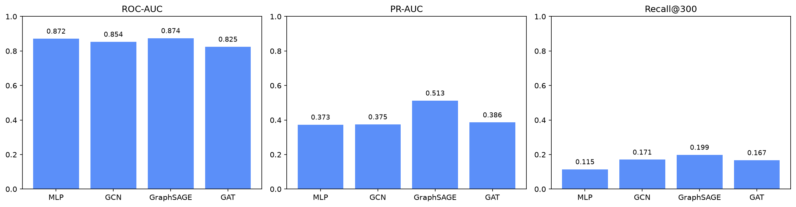
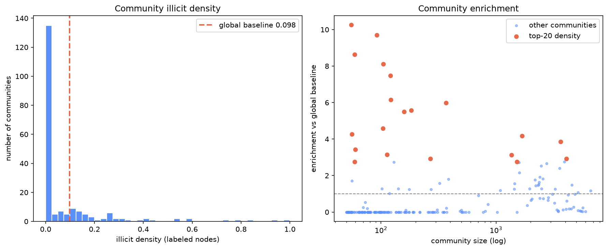

# GNN-based Bitcoin Fraud Detection (Elliptic)

Fraud detection on the Elliptic Bitcoin transaction graph using GNNs (GCN / GraphSAGE / GAT) combined with Louvain community detection. Evaluation is **recall-oriented** (PR-AUC, Recall@K) and benchmarked against a non-graph MLP baseline to quantify the value of graph structure.

## Highlights

- **Graph modeling**: transactions are nodes, payment flows are edges; message passing captures the structural signal of "who transacts with whom".
- **Leakage-free temporal split**: train / val / test are split strictly by time step (1–29 / 30–34 / 35–49) to prevent future information leaking into the past.
- **Recall-oriented evaluation**: main metrics are PR-AUC and Recall@K / Precision@K, not accuracy — the metrics that matter for imbalanced fraud detection.
- **Class imbalance handling**: illicit is only 9.76% of labeled nodes; handled with weighted BCE / Focal Loss.
- **Gang identification**: Louvain community detection surfaces high-density communities as suspected fraud gangs.
- **Reproducible**: fixed seeds, mean±std across 3 seeds, one-command end-to-end run.

## Problem

The Bitcoin transaction graph is anonymous but structured: each transaction (node) carries 165 anonymous features (166 in the original; this copy has one fewer column), and payment flows form directed edges. Only ~46k nodes are labeled (illicit / licit), the rest are unknown.

**Task**: predict the illicit probability of a transaction and surface high-risk communities.

**Why graphs**: the local network structure of a transaction (whom it transacts with, in what topology) is itself a strong signal that a feature-only model cannot see.

## Data

| Item | Value |
|---|---|
| Source | [Elliptic Bitcoin (Kaggle)](https://www.kaggle.com/datasets/ellipticco/elliptic-data-set) |
| Nodes | 203,769 transactions |
| Edges | 234,355 payment flows (468,710 after undirected conversion) |
| Features | 165 anonymous features |
| Time steps | 1 – 49 (edges never cross time steps; each step is its own connected component) |
| Labels | 4,545 illicit / 42,019 licit / 157,205 unknown |

> Note: the commonly-quoted "2% illicit" is relative to **all** nodes. The model is trained and evaluated on **labeled** nodes, where illicit is **9.76%** — this is the ratio used for class weighting.

## Method

```
data/raw CSVs
   │
   ▼ dataset.py    read CSV -> validate endpoints/self-loops -> build undirected graph -> z-score -> temporal split
PyG Data(x, edge_index, y, train/val/test mask)
   │
   ├──▶ models.py    MLP (non-graph baseline) / GCN / GraphSAGE / GAT
   │        │
   │        ▼ train.py     loss on train only, early stop on val; weighted BCE / Focal Loss
   │        ▼ evaluate.py  AUC / PR-AUC / Recall@K / F1 + ROC/PR curves
   │
   └──▶ community.py   networkx undirected graph -> Louvain -> high-density communities
```

### Key design decisions

1. **Temporal split (leakage-free)**: `train = labeled & time_step ≤ 29`, `val = 30–34`, `test = 35–49`. Early stopping and threshold selection use val only; test is held out and evaluated once.
2. **Label verification**: raw `classes.csv` uses `1 = illicit, 2 = licit`; the code hard-checks that the mapped counts match the published 4,545 / 42,019, catching flipped-label copies.
3. **Models**: single-logit output (positive class = illicit); GAT uses multi-head hidden layers with a single-head final layer.
4. **Feature standardization fitted on train only**: mean/std are computed on train nodes and applied to the whole graph, keeping test statistics out of training. Combined with edges never crossing time steps, training has zero contact with test nodes.
5. **Evaluation**: threshold-free PR-AUC / ROC-AUC as primary metrics; Recall@K / Precision@K (pool = labeled test nodes) as business metrics; F1 is a reference only (threshold picked on val).

## Results

Run `python -m src.main` (3 seeds × 100 epochs, early stopping) — full results in `output/metrics/metrics.csv`.

| Model | ROC-AUC | PR-AUC | Recall@100 | Recall@300 | F1 (ref) |
|---|---|---|---|---|---|
| MLP (non-graph baseline) | 0.872 | 0.374 | 0.037 | 0.115 | 0.504 |
| GCN | 0.854 | 0.375 | 0.059 | 0.171 | 0.419 |
| **GraphSAGE** | **0.874** | **0.513** | **0.086** | **0.199** | **0.549** |
| GAT | 0.825 | 0.386 | 0.057 | 0.167 | 0.419 |

(test has 16,670 labeled nodes, 1,083 of them illicit; the random-chance PR-AUC baseline is 6.5%)



**Key findings:**

1. **Graph structure helps, and it shows precisely on the recall-oriented metrics.** GraphSAGE is the best — PR-AUC **0.513**, Recall@300 **0.199**, F1 **0.549** — clearly above the MLP baseline (PR-AUC 0.374). All three GNNs' Recall@300 (0.167–0.199) are roughly 1.5–1.7× the MLP (0.115).
2. **The value appears in PR-AUC / Recall@K, not ROC-AUC.** All four models are close on ROC-AUC (0.82–0.87), but PR-AUC spreads from 0.37 to 0.51 — direct evidence that PR-AUC and recall, not AUC/accuracy, are the right metrics for imbalanced fraud detection.
3. **Gang identification.** Louvain finds communities with very high illicit density — the largest one has 87 illicit out of 92 labeled nodes (94.6% density, **9.7×** the 9.76% global baseline).



## Repository structure

```
gnn-fraud-detection/
├── data/raw/                # three CSVs (not committed; see data/raw/README.md)
├── src/
│   ├── config.py            # paths, hyperparameters, temporal split, evaluation settings
│   ├── dataset.py           # loading + validation + graph construction + split (core)
│   ├── models.py            # MLP / GCN / GraphSAGE / GAT
│   ├── train.py             # training loop + imbalance handling + early stopping
│   ├── evaluate.py          # AUC/PR-AUC/Recall@K/F1 + curves
│   ├── community.py         # Louvain gang detection
│   └── main.py              # one-command end-to-end pipeline
├── notebooks/01_eda.ipynb   # graph EDA
├── scripts/
│   ├── download_data.py     # dataset download helper
│   └── regenerate_figures.py# regenerate figures from saved weights (no retraining)
├── tests/test_dataset.py    # unit tests for loading and splitting
├── output/                  # metrics.csv / figures / model weights
└── requirements.txt
```

## Quick start

### 1. Environment (project-local venv)

```bash
python -m venv .venv
# Windows
.venv\Scripts\activate
# China mirror (optional)
pip install -i https://pypi.tuna.tsinghua.edu.cn/simple -r requirements.txt
```

### 2. Data

Download the three CSVs from [Kaggle](https://www.kaggle.com/datasets/ellipticco/elliptic-data-set) into `data/raw/`, or run:

```bash
python scripts/download_data.py
```

### 3. Tests (no real data required)

```bash
.venv\Scripts\python -m pytest tests -v
```

### 4. Full pipeline

```bash
.venv\Scripts\python -m src.main
```

Outputs: `output/metrics/metrics.csv`, `output/metrics/community_stats.csv`, `output/metrics/by_degree.csv`, and per-model ROC/PR/Recall@K figures plus `community.png` and `model_comparison.png`.

### 5. EDA

`notebooks/01_eda.ipynb` is pre-executed with embedded charts. To re-run it, open it in VS Code and select the "Python (gnnfraud)" kernel (or run `python -m pip install notebook` then `jupyter notebook`).

## References

- [RMIT-BDSL/Blockchain-Anomaly-Detection](https://github.com/RMIT-BDSL/Blockchain-Anomaly-Detection) — leakage-free temporal split
- [HiteshAvula09](https://github.com/HiteshAvula09) — PyG data processing and GCN/GraphSAGE/GAT comparison
- PyTorch Geometric documentation

## License

MIT

---

# 基于图神经网络的比特币欺诈识别（Elliptic）

在 Elliptic 比特币交易图上，用 GNN（GCN / GraphSAGE / GAT）结合 Louvain 社区发现做欺诈识别；评估以**召回为导向**（PR-AUC、Recall@K），并与非图基线 MLP 对比，量化图结构信息的价值。

## 项目亮点

- **图建模**：交易为节点、支付流为边，消息传递捕获"和谁交易"的结构信号。
- **防泄漏时间切分**：train / val / test 严格按时间步切分（1–29 / 30–34 / 35–49），杜绝未来信息泄漏到过去。
- **召回导向评估**：主指标是 PR-AUC 与 Recall@K / Precision@K，而非准确率——这才是不平衡欺诈任务真正该看的指标。
- **类别不平衡处理**：非法仅占有标签节点的 9.76%，用带权 BCE / Focal Loss 处理。
- **团伙识别**：Louvain 社区发现定位高欺诈密度社区（疑似团伙）。
- **可复现**：固定种子、3 个 seed 报 mean±std、一键跑全流程。

## 问题定义

比特币交易图匿名但有结构：每笔交易（节点）带 165 维匿名特征（原始为 166 维，本副本少一列），支付流构成有向边。约 4.6 万节点有标签（非法/合法），其余未知。

**任务**：预测交易的非法概率，并识别高风险社区。

**为什么用图**：交易的局部网络结构（和谁交易、何种拓扑）本身就是纯特征模型拿不到的强信号。

## 数据

| 项 | 值 |
|---|---|
| 来源 | [Elliptic Bitcoin (Kaggle)](https://www.kaggle.com/datasets/ellipticco/elliptic-data-set) |
| 节点 | 203,769 笔交易 |
| 边 | 234,355 条支付流（转无向后 468,710） |
| 特征 | 165 维匿名特征 |
| 时间步 | 1 – 49（边从不跨时间步，每个时间步是独立连通分量） |
| 标签 | 4,545 非法 / 42,019 合法 / 157,205 未知 |

> 口径说明：常说的"非法 2%"是相对**全部节点**；模型面向的是**有标签节点**，其中有标签节点里非法占 **9.76%**——类别权重按这个比例设。

## 方法

（数据流与英文版一致，略）

### 关键设计

1. **时间切分（防泄漏）**：`train = 有标签且 time_step ≤ 29`，`val = 30–34`，`test = 35–49`；早停与阈值选择只用 val，test 封存、只评一次。
2. **标签校验**：原始 `classes.csv` 中 `1=非法、2=合法`；代码硬校验映射后计数等于公开的 4545 / 42019，防止标签翻转的副本。
3. **模型**：单 logit 输出（正类=非法）；GAT 隐藏层多头、最后一层单头。
4. **特征标准化只用 train 拟合**：mean/std 只在 train 节点上计算、套到全图，test 统计量不进训练。配合"边不跨时间步"，训练过程对 test 零接触。
5. **评估口径**：阈值无关的 PR-AUC / ROC-AUC 为主指标；Recall@K / Precision@K（池子=有标签 test 节点）为业务指标；F1 仅作参考（阈值在 val 上选）。

## 结果

| 模型 | ROC-AUC | PR-AUC | Recall@100 | Recall@300 | F1（参考） |
|---|---|---|---|---|---|
| MLP（非图基线） | 0.872 | 0.374 | 0.037 | 0.115 | 0.504 |
| GCN | 0.854 | 0.375 | 0.059 | 0.171 | 0.419 |
| **GraphSAGE** | **0.874** | **0.513** | **0.086** | **0.199** | **0.549** |
| GAT | 0.825 | 0.386 | 0.057 | 0.167 | 0.419 |

（test 有标签 16,670 节点，其中非法 1,083；随机基线 PR-AUC = 6.5%）

**结论：**

1. **图结构有效，且体现在召回导向指标上**：GraphSAGE 最优——PR-AUC **0.513**、Recall@300 **0.199**、F1 **0.549**，明显高于 MLP 基线（PR-AUC 0.374）；三种 GNN 的 Recall@300（0.167~0.199）约为 MLP（0.115）的 1.5~1.7 倍。
2. **价值体现在 PR-AUC / Recall@K 而非 ROC-AUC**：四个模型 ROC-AUC 都在 0.82~0.87 很接近，但 PR-AUC 从 0.37 拉到 0.51——正是不平衡欺诈任务要看 PR-AUC/召回的直接证据。
3. **团伙识别**：Louvain 发现高密度社区——最大一个 92 个有标签节点里 87 个非法（密度 94.6%，是全局基线 9.76% 的 **9.7 倍**）。

## 快速开始

```bash
python -m venv .venv
.venv\Scripts\activate
pip install -i https://pypi.tuna.tsinghua.edu.cn/simple -r requirements.txt
# 下载数据到 data/raw/（见 data/raw/README.md）
.venv\Scripts\python -m src.main          # 跑全流程
.venv\Scripts\python -m pytest tests -v   # 跑测试
```

## License

MIT
